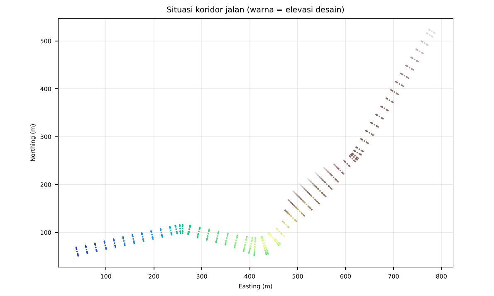
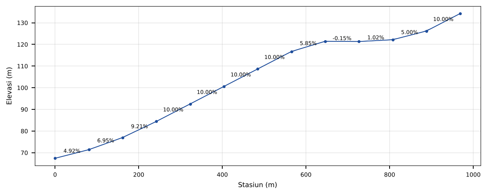
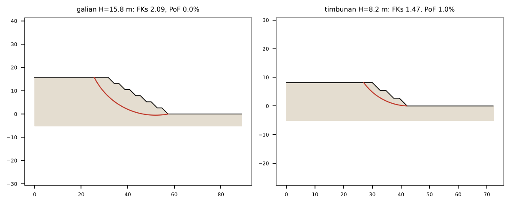
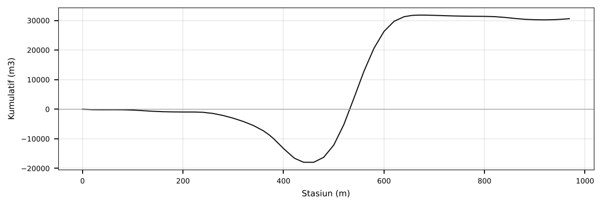
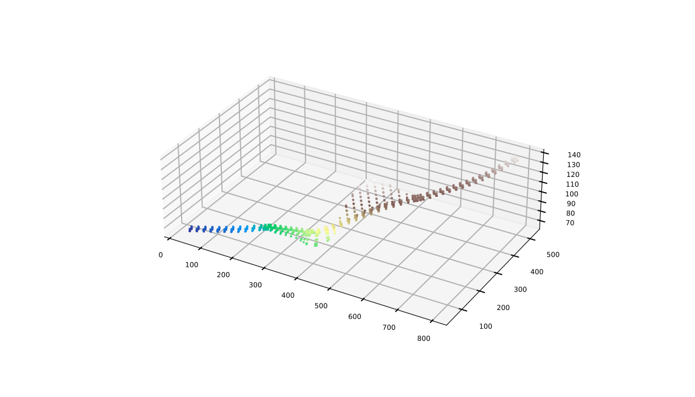

# LAPORAN PERENCANAAN JALAN TAMBANG

**Rencana Jalan Hauling - format paket gambar standar**

PT. Surya Saga Utama | IUP ISI nomor IUP | ISI desa, kecamatan, kabupaten

No. dokumen SSU-JLN-LAP | Revisi 0 | 22-11-2026

## LEMBAR PENGESAHAN

| Digambar | Diperiksa | Disetujui (KTT) |
|---|---|---|
| ( ............ ) | ( ............ ) | ( ............ ) |

## BAB 1  PENDAHULUAN

### 1.1  Latar Belakang

Jalan tambang HR-01 direncanakan sebagai jalan angkut sepanjang 968,80 m (STA 0+000.00 s.d. 0+968.80). Perencanaan wajib memenuhi kaidah teknik pertambangan yang baik sebagaimana Keputusan Menteri ESDM Nomor 1827 K/30/MEM/2018, khususnya ketentuan jalan pertambangan (hal. 99-100) dan perencanaan pengangkutan (hal. 66-67).

### 1.2  Maksud dan Tujuan

- Menetapkan geometri jalan (alinyemen horizontal, vertikal, dan penampang melintang) yang aman bagi unit angkut terbesar.
- Menghitung volume pekerjaan tanah (galian, timbunan, perkerasan).
- Memeriksa kepatuhan terhadap Kepmen ESDM 1827 K/30/MEM/2018 dan praktik rekayasa yang diakui.
- Menyiapkan gambar rencana dan data digital (LandXML/DXF) untuk pelaksanaan dan pengesahan KTT.

### 1.3  Lokasi dan Lingkup

| Uraian | Keterangan |
|---|---|
| Perusahaan | PT. Surya Saga Utama |
| Nomor IUP | ISI nomor IUP |
| Lokasi | ISI desa, kecamatan, kabupaten |
| Sistem koordinat | UTM Zona 51S, Datum WGS 84 (EPSG:32751) |
| Trase | HR-01: STA 0+000.00 - 0+968.80 |
| Panjang | 968,80 m |
| Jumlah jalur | 2 |
| Kecepatan rencana | 30 km/jam |

*Gambar 1.1  Situasi trase jalan*

### 1.4  Dasar Acuan

- Peraturan Menteri ESDM Nomor 26 Tahun 2018 tentang Pelaksanaan Kaidah Pertambangan yang Baik dan Pengawasan Pertambangan Minerba.
- Keputusan Menteri ESDM Nomor 1827 K/30/MEM/2018 tentang Pedoman Pelaksanaan Kaidah Teknik Pertambangan yang Baik.
- AASHTO, A Policy on Geometric Design of Highways and Streets (praktik rekayasa: radius, superelevasi, jarak pandang, lengkung vertikal).
- Kaufman & Ault, Design of Surface Mine Haulage Roads, USBM IC 8758 (praktik rekayasa: lebar tikungan, tebal perkerasan).
- SNI 1726 (beban gempa) untuk koefisien seismik analisis lereng.

## BAB 2  DATA DAN ASUMSI

### 2.1  Data Topografi

Sumber topografi: ISI: foto udara/LiDAR, tanggal, akurasi. Kepmen 1827 mensyaratkan peta topografi skala 1:2.000 dengan akurasi 1 m (hal. 50); gambar rencana plan & profile disusun pada skala horizontal 1:2.000.

### 2.2  Unit Angkut Terbesar

| Parameter | Nilai |
|---|---|
| Model | ISI: dump truck terbesar |
| Lebar unit | 2.85 m |
| Diameter roda | 1.1 m |
| Lebar roda | 0.3 m |
| Jarak jejak roda | 2.1 m |
| Wheelbase | 4.7 m |
| Juntai depan / belakang | 1.4 / 2.0 m |
| Berat kotor (GVW) | 42.0 t |
| Tinggi mata pengemudi | 2.4 m |

### 2.3  Parameter Desain

| Parameter | Nilai |
|---|---|
| Tipe penampang | saluran_tanggul_dua_sisi |
| Gesekan samping f / superelevasi maks | 0.12 / 5% |
| Grade maksimum desain | 10.0% |
| Kemiringan melintang | 2.0% |
| Saluran (dasar x dalam, sisi) | 0.6 x 1.0 m, 0.3H:1V |
| Intensitas hujan rencana | 100.0 mm/jam |
| Lereng galian | 1.0H:1V, jenjang 2.0 m tiap 3.0 m |
| Lereng timbunan | 1.0H:1V, jenjang 2.0 m tiap 3.0 m |
| Lapis perkerasan | 0.3 m sirtu/laterit dipadatkan (CBR tanah dasar 6.0%) |
| Interval penampang hitungan / gambar | 20 m / 100 m |

### 2.4  Asumsi

- Topografi dianggap mewakili kondisi lapangan terkini; perubahan kontur > 1 m memerlukan pembaruan desain.
- Spesifikasi unit angkut sesuai Tabel 2.2; bila unit terbesar berubah, lebar, tanggul, dan tikungan harus dihitung ulang.
- Parameter geoteknik: ASUMSI - ganti dengan hasil uji laboratorium.
- DATA DEMO (sintetis): seluruh angka hanya contoh, bukan data proyek.

## BAB 3  KRITERIA DESAIN

Ketentuan yang bersumber dari Kepmen ESDM 1827 K/30/MEM/2018 dicantumkan dengan nomor halaman. Ketentuan yang tidak diberi angka oleh Kepmen dihitung dengan metode rekayasa dan ditandai "praktik rekayasa".

| Item | Kriteria | Dasar |
|---|---|---|
| Lebar jalan lurus | >= 3.5 x lebar unit (2 jalur); >= 2.0 x (1 jalur) | Kepmen hal. 99 (i) |
| Tanggul pengaman | >= 0.75 x diameter roda terbesar | Kepmen hal. 99 (ii) |
| Drainase | mampu mengalirkan debit limpasan tertinggi | Kepmen hal. 99 (v) |
| Kemiringan melintang | >= 2% | Kepmen hal. 99 (vi) |
| Kemiringan memanjang | <= 12% (lebih: kajian teknis) | Kepmen hal. 99 (vii), 100 (viii) |
| Tikungan | lebar, radius, superelevasi sesuai gaya kendaraan pada batas kecepatan | Kepmen hal. 100 (ix) |
| Daya dukung | > beban statis unit terbesar bermuatan | Kepmen hal. 100 (xi) |
| Separator | >= 0.5 x D roda; lebar atas >= lebar roda | Kepmen hal. 100 (xii) |
| Persimpangan | >= 70 derajat | Kepmen hal. 100 (xiii) |
| Kapasitas jalan | >= laju produksi + 25% | Kepmen hal. 67 |
| Lereng galian/timbunan | FK & PoF Tabel 1; timbunan dengan parameter residual | Kepmen hal. 57-58 |
| Radius minimum | R = V^2 / (127 (e + f)) | Praktik rekayasa (AASHTO) |
| Lebar tikungan | W = n(U + Fa + Fb + Z) + C; off-tracking | Praktik rekayasa |
| Jarak pandang henti & lengkung vertikal | AASHTO | Praktik rekayasa |
| Tebal perkerasan | kurva CBR | Praktik rekayasa (Kaufman & Ault) |

## BAB 4  HASIL PERENCANAAN

### 4.1  Alinyemen Horizontal

Radius minimum untuk V = 30 km/jam: R = V^2/(127(e+f)) = 30^2/(127 x (0.05 + 0.12)) = 41,69 m.

| PI | Arah | R (m) | Delta (deg) | T (m) | L (m) | e | W (m) | STA PC | STA PT |
|---|---|---|---|---|---|---|---|---|---|
| 1 | kanan | 60 | 26,04 | 13,88 | 27,27 | 0.0% | 10,34 | 0+211.73 | 0+239.01 |
| 2 | kiri | 50 | 58,24 | 27,85 | 50,82 | 2.2% | 10,42 | 0+371.92 | 0+422.74 |
| 3 | kiri | 70 | 13,39 | 8,22 | 16,36 | 0.0% | 10,29 | 0+655.37 | 0+671.74 |

### 4.2  Alinyemen Vertikal

| Segmen | Panjang (m) | Grade |
|---|---|---|
| 0+000.00 - 0+080.73 | 80,73 | 4.92% |
| 0+080.73 - 0+161.47 | 80,73 | 6.95% |
| 0+161.47 - 0+242.20 | 80,73 | 9.21% |
| 0+242.20 - 0+322.93 | 80,73 | 10.00% |
| 0+322.93 - 0+403.67 | 80,73 | 10.00% |
| 0+403.67 - 0+484.40 | 80,73 | 10.00% |
| 0+484.40 - 0+565.14 | 80,73 | 10.00% |
| 0+565.14 - 0+645.87 | 80,73 | 5.85% |
| 0+645.87 - 0+726.60 | 80,73 | -0.15% |
| 0+726.60 - 0+807.34 | 80,73 | 1.02% |
| 0+807.34 - 0+888.07 | 80,73 | 5.00% |
| 0+888.07 - 0+968.80 | 80,73 | 10.00% |

Jarak pandang henti (JPH) = 0,278 V t + V^2 / (254 (f - G)) = 32,72 m (praktik rekayasa).

| PVI | Jenis | A (%) | L perlu (m) | L desain (m) |
|---|---|---|---|---|
| 0+080.73 | cekung | 2,03 | 0,0 | 20 |
| 0+161.47 | cekung | 2,26 | 0,0 | 20 |
| 0+242.20 | cekung | 0,79 | 0,0 | 20 |
| 0+565.14 | cembung | 4,15 | 0,0 | 20 |
| 0+645.87 | cembung | 6,00 | 0,0 | 20 |
| 0+726.60 | cekung | 1,17 | 0,0 | 20 |
| 0+807.34 | cekung | 3,97 | 6,4 | 20 |
| 0+888.07 | cekung | 5,00 | 18,6 | 20 |

*Gambar 4.1  Profil memanjang*

### 4.3  Penampang Melintang

Lebar jalur lalu lintas lurus 9,98 m (rumus L = n.Wt + (n+1)(0,5.Wt) = 9,98 m; minimum Kepmen 9,97 m). Tanggul pengaman setinggi 1,50 m. Kemiringan melintang 2.0% (crown). Tinggi galian maksimum 15,76 m dan tinggi timbunan maksimum 8,17 m.

### 4.4  Drainase

Kapasitas saluran (Manning, n = 0.03, kemiringan dasar 0.5%): Q = 1,023 m3/detik. Debit rencana (rasional, C = 0.9, I = 100.0 mm/jam, panjang tangkapan 200 m): Q = 0,077 m3/detik. Gorong-gorong/sump ditempatkan paling jauh setiap 200 m dan di setiap titik rendah profil.

### 4.5  Perkerasan dan Daya Dukung

Beban roda 3.518 kg, tekanan ban 700 kPa, CBR tanah dasar 6.0% -> tebal perlu 0,30 m; tebal rencana 0,30 m.

### 4.6  Kestabilan Lereng Galian dan Timbunan

Analisis Bishop disederhanakan + Monte Carlo (PoF), CoF = tinggi, ru = 0.2, kh = 0.1. Parameter: ASUMSI - ganti dengan hasil uji laboratorium.

| Lereng | STA | H (m) | Sudut | FK statis | FK dinamis | PoF | Syarat | Status |
|---|---|---|---|---|---|---|---|---|
| galian | 0+540.00 | 15,8 | 31.5 deg | 2,09 | 1,71 | 0.0% | >= 1.5 / 1.1 / <= 5% | MEMENUHI |
| timbunan | 0+397.33 | 8,2 | 33.9 deg | 1,47 | 1,21 | 1.0% | >= 1.5 / 1.1 / <= 5% | TIDAK MEMENUHI |

*Gambar 4.2  Bidang gelincir kritis lereng tertinggi*

### 4.7  Volume Pekerjaan

| Pekerjaan | Volume (m3) | Keterangan |
|---|---|---|
| Galian | 52.118,24 | average end area, penampang tiap 20 m (TIN: 52.370,24) |
| Timbunan | 19.357,73 | (TIN: 19.128,32) |
| Lapis perkerasan | 2.899,15 | lebar jalur x tebal x panjang |
| Neraca | 27.548,69 | galian x faktor susut 0.9 - timbunan (negatif = perlu material timbun dari luar) |

*Gambar 4.3  Diagram mass-haul*

*Gambar 4.4  Model 3D koridor jalan*

## BAB 5  PEMERIKSAAN KEPATUHAN

| No | Item | Nilai desain | Syarat | Status | Dasar |
|---|---|---|---|---|---|
| 1 | Lebar jalur lalu lintas lurus | 9.98 m | >= 9.97 m (3.5 x 2.85 m) | MEMENUHI | Kepmen 1827 hal. 99 (i) |
| 2 | Tikungan PI1 (R=60 m, kanan) | R=60 m, W=10.34 m, e=0.0% | R >= 41.7 m @ 30 km/j; e perlu 0.0% | MEMENUHI | Kepmen 1827 hal. 100 (ix) |
| 3 | Tikungan PI2 (R=50 m, kiri) | R=50 m, W=10.42 m, e=2.2% | R >= 41.7 m @ 30 km/j; e perlu 2.2% | MEMENUHI | Kepmen 1827 hal. 100 (ix) |
| 4 | Tikungan PI3 (R=70 m, kiri) | R=70 m, W=10.29 m, e=0.0% | R >= 41.7 m @ 30 km/j; e perlu 0.0% | MEMENUHI | Kepmen 1827 hal. 100 (ix) |
| 5 | Tanggul pengaman (safety berm) | tinggi 1.50 m | >= 0.75 x 1.1 m = 0.83 m | MEMENUHI | Kepmen 1827 hal. 99 (ii) |
| 6 | Kemiringan melintang (cross fall) | 2.0% | >= 2% | MEMENUHI | Kepmen 1827 hal. 99 (vi) |
| 7 | Kemiringan memanjang (grade) maksimum | 10.00% | <= 12% (target desain 10%) | MEMENUHI | Kepmen 1827 hal. 99 (vii) |
| 8 | Saluran drainase (Manning vs metode rasional) | Qkap=1.023 m3/s | >= Qrencana=0.077 m3/s | MEMENUHI | Kepmen 1827 hal. 99 (v) |
| 9 | Daya dukung / tebal lapis perkerasan | 0.30 m | >= 0.30 m (CBR tanah dasar 6.0%) | MEMENUHI | Kepmen 1827 hal. 100 (xi) |
| 10 | Separator di tikungan/persimpangan (spesifikasi) | tinggi 0.55 m, lebar atas 0.30 m | >= 1/2 x D roda; lebar atas >= lebar roda | MEMENUHI | Kepmen 1827 hal. 100 (xii) |
| 11 | Lengkung vertikal cekung STA 0+080.73 | L=20 m (A=2.0%) | L >= 0 m (JPH 33 m) | MEMENUHI | Praktik rekayasa AASHTO (Kepmen tidak memberi angka jarak pandang) |
| 12 | Lengkung vertikal cekung STA 0+161.47 | L=20 m (A=2.3%) | L >= 0 m (JPH 33 m) | MEMENUHI | Praktik rekayasa AASHTO (Kepmen tidak memberi angka jarak pandang) |
| 13 | Lengkung vertikal cembung STA 0+565.14 | L=20 m (A=4.1%) | L >= 0 m (JPH 33 m) | MEMENUHI | Praktik rekayasa AASHTO (Kepmen tidak memberi angka jarak pandang) |
| 14 | Lengkung vertikal cembung STA 0+645.87 | L=20 m (A=6.0%) | L >= 0 m (JPH 33 m) | MEMENUHI | Praktik rekayasa AASHTO (Kepmen tidak memberi angka jarak pandang) |
| 15 | Lengkung vertikal cekung STA 0+726.60 | L=20 m (A=1.2%) | L >= 0 m (JPH 33 m) | MEMENUHI | Praktik rekayasa AASHTO (Kepmen tidak memberi angka jarak pandang) |
| 16 | Lengkung vertikal cekung STA 0+807.34 | L=20 m (A=4.0%) | L >= 6 m (JPH 33 m) | MEMENUHI | Praktik rekayasa AASHTO (Kepmen tidak memberi angka jarak pandang) |
| 17 | Lengkung vertikal cekung STA 0+888.07 | L=20 m (A=5.0%) | L >= 19 m (JPH 33 m) | MEMENUHI | Praktik rekayasa AASHTO (Kepmen tidak memberi angka jarak pandang) |
| 18 | Lereng galian maks (H 15.8 m, STA 0+540.00) | FKs 2.09, FKd 1.71, PoF 0.0% | FKs >= 1.5, FKd >= 1.1, PoF <= 5% (CoF tinggi) | MEMENUHI | Kepmen 1827 Tabel 1 hal. 57 |
| 19 | Lereng timbunan maks (H 8.2 m, STA 0+397.33) | FKs 1.47, FKd 1.21, PoF 1.0% | FKs >= 1.5, FKd >= 1.1, PoF <= 5% (CoF tinggi) | TIDAK MEMENUHI | Kepmen 1827 Tabel 1 hal. 57, timbunan: parameter residual hal. 58 |

## BAB 6  KESIMPULAN DAN REKOMENDASI

### 6.1  Kesimpulan

Terdapat 1 butir yang belum memenuhi kriteria dan wajib diperbaiki sebelum pengesahan.

### 6.2  Rekomendasi Perbaikan

1. Lereng timbunan maks (H 8.2 m, STA 0+397.33): landaikan lereng, perlebar jenjang, kendalikan air (drainase lereng, ru), atau perkuatan; lakukan uji laboratorium untuk parameter aktual.

### 6.3  Pengendalian Keselamatan dan Pemantauan

1. Pasang rambu batas kecepatan 30 km/jam, rambu tikungan, tanjakan/turunan, dan persimpangan.
2. Inspeksi harian tanggul pengaman, saluran, dan permukaan jalan; perbaiki erosi, lubang, dan genangan.
3. Pemantauan lereng galian/timbunan (inspeksi visual tiap shift saat hujan, patok/prisma geser untuk lereng tinggi).
4. Penyiraman jalan untuk pengendalian debu dan pengaturan jarak antar unit.
5. Verifikasi as-built (survei) setelah konstruksi dan sebelum jalan dioperasikan; dokumentasikan untuk KTT.

## LAMPIRAN

### A. Daftar Gambar

| No | Nomor gambar | Judul |
|---|---|---|
| 1 | SSU-JLN-01 | Peta situasi trase & indeks lembar |
| 2 | SSU-JLN-02 | Plan & profile STA 0+000.00 - 0+523.40 |
| 3 | SSU-JLN-03 | Plan & profile STA 0+503.40 - 0+968.80 |
| 4 | SSU-JLN-04 | Penampang jalan tipikal |
| 5 | SSU-JLN-05 | Penampang melintang STA 0+000.00 - 0+100.00 |
| 6 | SSU-JLN-06 | Penampang melintang STA 0+200.00 - 0+300.00 |
| 7 | SSU-JLN-07 | Penampang melintang STA 0+400.00 - 0+500.00 |
| 8 | SSU-JLN-08 | Penampang melintang STA 0+600.00 - 0+700.00 |
| 9 | SSU-JLN-09 | Penampang melintang STA 0+800.00 - 0+900.00 |
| 10 | SSU-JLN-10 | Penampang melintang STA 0+968.80 - 0+968.80 |
| 11 | SSU-JLN-11 | Tabel volume galian & timbunan |

### B. Daftar Berkas Digital

| Berkas | Isi |
|---|---|
| gambar_perencanaan_jalan.pdf | Paket gambar (situasi, plan & profile, penampang, volume) |
| jalan.xml | LandXML 1.2: alignment, profile, cross section, surface EG/FG/komposit |
| jalan_plan.dxf / jalan_3d.dxf | Denah 2D berlapis NCS / feature line & TIN 3D |
| jalan_profil.dxf / jalan_penampang.dxf | Profil memanjang / penampang melintang |
| koridor.obj/.stl, komposit.obj | Model 3D |
| volume.csv, titik_koridor.csv | Volume per stasiun, titik PENZD |
| laporan.json | Data perhitungan lengkap |

Hasil perencanaan ini adalah alat bantu teknis. Pengesahan dan keputusan pelaksanaan tetap berada pada Kepala Teknik Tambang (KTT).

